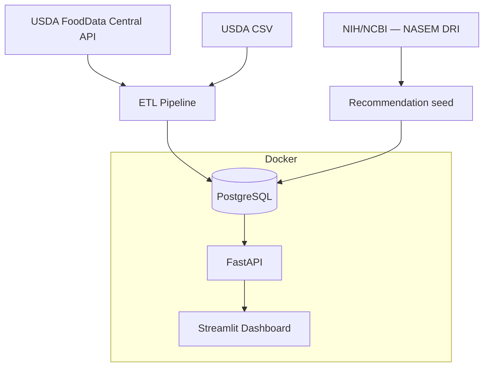

# Nutribalance

> How do you analyse your diet to determine whether you are meeting your nutritional needs?

Each person has physiological characteristics that determine their daily nutrient requirements. NutriBalance records your actual food intake and compares it against official reference values to evaluate whether your diet adequately covers those needs.

---

## Architecture


---

## Tech stack

| Layer | Technology |
|---|---|
| Language | Python 3.14 |
| Database | PostgreSQL 18 |
| ETL | pandas, psycopg2, requests |
| API | FastAPI, uvicorn, pydantic |
| Dashboard | Streamlit, Plotly |
| Deployment | Docker, docker-compose |

---

## Data source

| Source | Type | Used for |
|---|---|---|
| [USDA FoodData Central](https://fdc.nal.usda.gov/) | API + CSV | Foods, nutrients, categories, portions |
| [NIH/NCBI — NASEM DRI](https://www.ncbi.nlm.nih.gov/books/NBK56068/) | Web tables | RDA/AI and UL recommendations |
 
- **Foundation Foods** (~436 foods) and **SR Legacy** (~7,794 foods) via USDA `/foods/list` endpoint
- **nutrient.csv** — USDA nutrient catalog used to map nutrient numbers from the API to internal USDA IDs. Required before running the ETL pipeline.
- Nutritional recommendations cover 22 nutrients across sex, age range (19–30, 31–50, 51–70, 71+) and physiological condition (none, pregnancy, lactation)

---

## Clone the repository
```bash
git clone https://github.com/leticia-gerperangel/NutriBalance
```

## Configure environment variables
```bash
cp .env-example .env 
```

Edit .env with your credentials

## Start

```bash
docker-compose up
```


### Load data
```bash
docker-compose exec api python -m scripts.load_nutrient_catalog
```

### Run ETL pipeline
```bash
docker-compose exec api python -m scripts.run_etl
```

### Load nutrional recommendation
```bash
docker-compose exec api python -m scripts.load_recommendation_seed
```

### Open the dashboard

Visit `http://localhost:8501` and create an account to start logging your daily food intake.

---

## Running tests
```bash
python -m pytest test -v
```

---

## Key design decisions

- `/foods/list` **as the single API source**: this endpoint returns complete nutrient data for each food in a single paginated call, eliminating the need for a second request per food item. Alternative endpoints were evaluated and discarded due to timeout issues and impractical request volumes for more than 8000 foods.

- `nutrient_catalog` **as an ETL prerequisite**: the USDA API identifies nutrients by a number (`nutrient_nbr`) instead of an internal ID. Before the ETL runs, `nutrient.csv` is loaded into an auxiliary table that stores that mapping so the pipeline can correctly link API nutrient data to the database.

- **CSV for data enrichment**: food category and portion size are not included in the API response. These fields are loaded from additional USDA CSV downloads and joined during the ETL transformation step.

- **Incremental ETL**: `ON CONFLICT DO NOTHING` makes the pipeline idempotent and safely re-runnable without creating duplicates. 

- **FastAPI as an intermediate layer**: a REST API decouples the dashboard from the database and demonstrates API design skills.


## Lessons learned

- API performance evaluation - I initially used an endpoint that returned full food details but caused constant timeouts. To solve this, I combined a simpler endpoint with complementary CSV data sources, reducing the ETL execution time from hours to minutes. The best solution is not always the most complete one.

- Domain knowledge matters in data projects - I had to understand concepts like RDA, UL and EER before I could model the data correctly.

- Iterative data modelling - the schema evolved throughout the project. What seemed complete at first needed adjustments as the domain requirements became clearer.

- Docker makes a project reproducible - I initially wanted to deploy the project online but each service required a different platform. Docker solved this by packaging everything together, so anyone can run the full stack with a single command regardless of their environment.


## Notes

- Energy analysis uses NASEM DRI 2005 equation for caloric analysis (ERR).

- Nutrient recommendations are based on RDA/AI values from NIH/NCBI: NASEM DRI. Upper Intake Levels (UL) are included for applicable nutrients.
